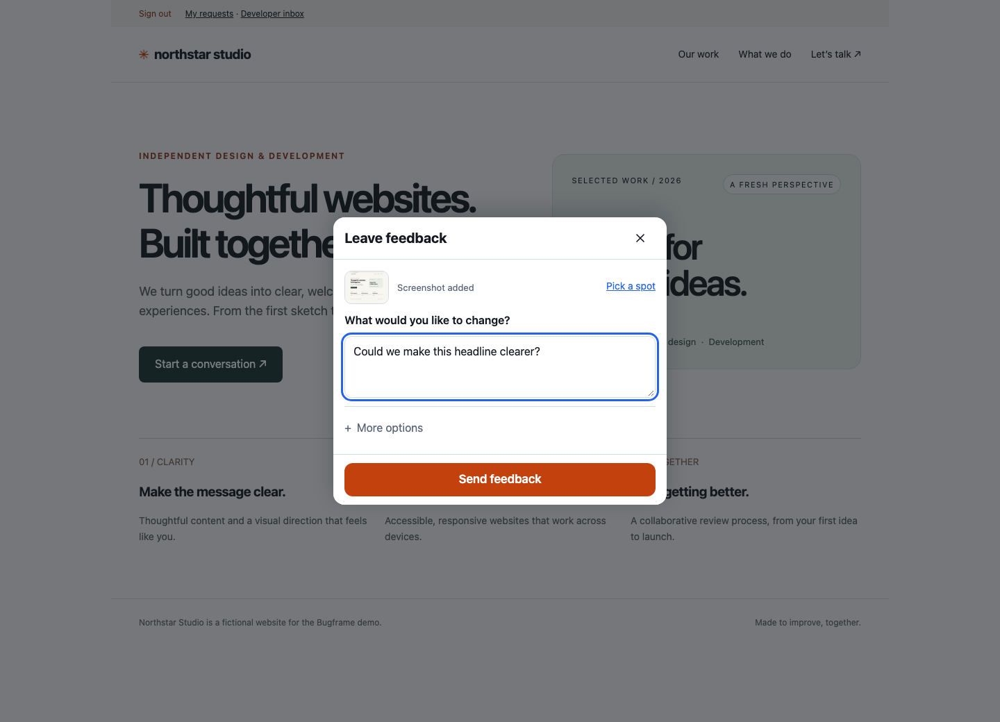
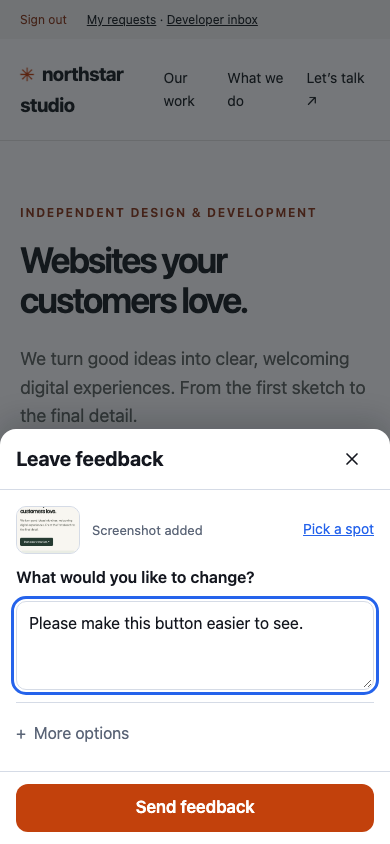
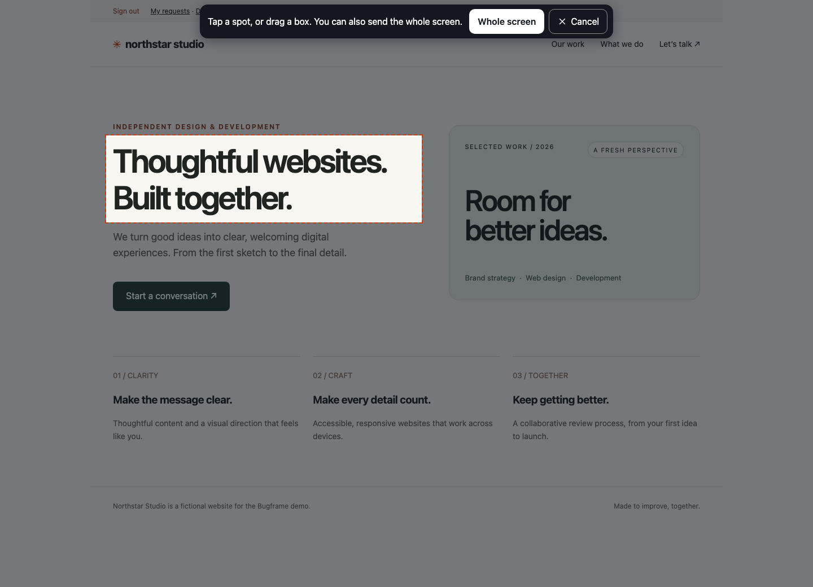
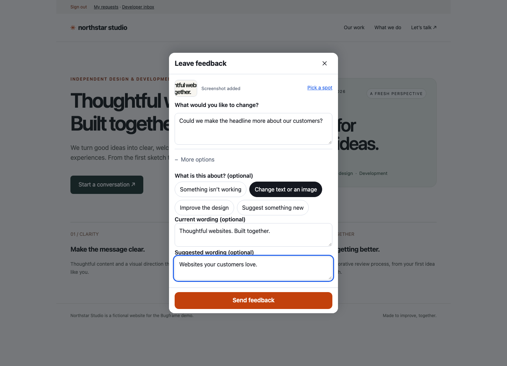
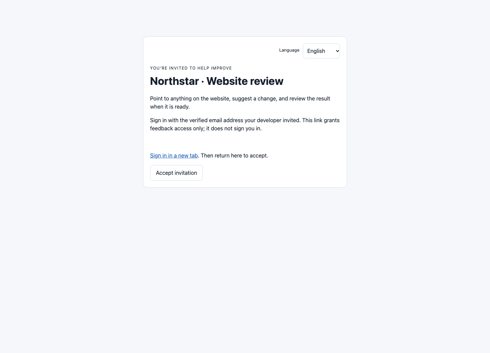
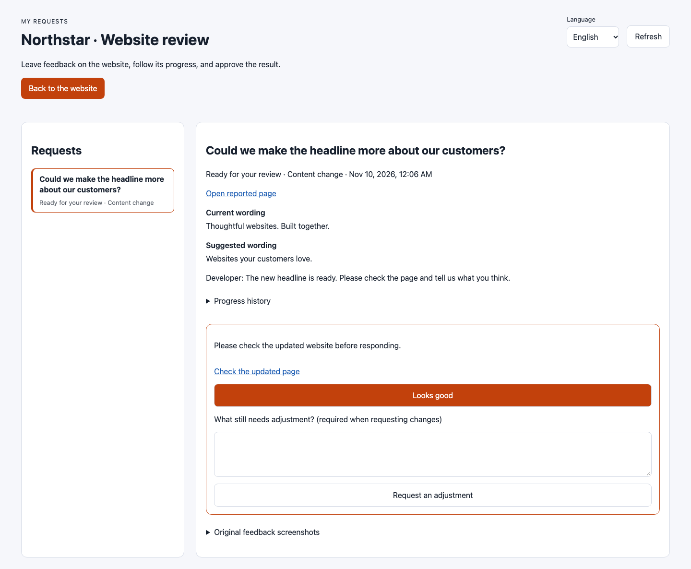
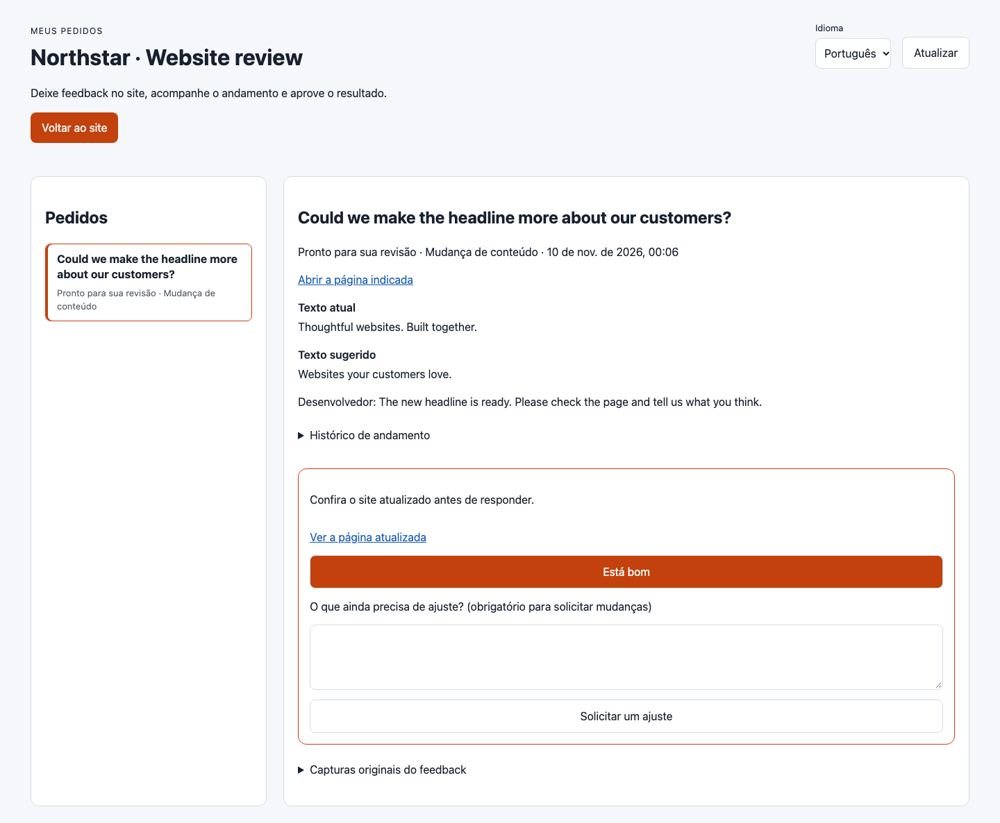

# Bugframe

### Point at the problem. Give your developer the whole picture.

Open-source website feedback for humans and coding agents. Capture a screenshot, describe a change, and follow it all the way to customer approval.

[](https://github.com/vmatheus3/bug-frame/actions/workflows/ci.yml)
[](LICENSE)
[](https://github.com/vmatheus3/bug-frame/releases/tag/v0.5.0)

[Try locally](#5-minute-quick-start) · [Add to your app](#add-it-to-your-own-project) · [Connect Codex](#new-tickets--codex-inbox) · [See the interface](docs/MOCKUPS.md) · [Contribute](#contributing)



**Your customer writes “the total is wrong.” You get the screenshot, page URL, viewport, and element context.** Optional console capture adds recent browser errors. No more asking which page, which phone, or which button.

| From feedback to a verified change | Built in |
| --- | --- |
| **Capture in context** | Automatic screenshots, optional point-and-drag selection, bugs, design feedback, content changes, and ideas. |
| **Triage without the tab hunt** | A private inbox with search, status and kind filters, sorting, screenshots, and request history. |
| **Hand the context to your coding agent** | Copy a report as Markdown, export a worklist grouped by page, or connect new-ticket notifications to Codex. |
| **Close the loop** | Deliver a change with a note. The customer checks the live page, approves, or requests an adjustment. |

**Your infrastructure. Your reports. MIT licensed.** No Bugframe account, subscription, or analytics. Use your existing website login, keep reports on your server, or collect ZIP files without a server. Hosting and any optional AI service are yours to choose.

## 5-minute quick start

Try the complete widget and server locally with Node.js 20+ (the runtime server/CLI also support 18.17+):

```bash
git clone https://github.com/vmatheus3/bug-frame.git
cd bug-frame
npm ci
npm run build
npm run example
```

Open <http://127.0.0.1:4455/?bugs=1> and follow **Sign in as an approved tester**. The terminal prints a random demo password.
Once signed in, report the deliberately wrong invoice total, then try **My requests**. Signing out revokes the session.
Reports are stored in `examples/plain-html/reports/`. This localhost demo uses an HttpOnly session cookie; integrate your own website login in production.
In another terminal in the repository:

```bash
node src/cli/bin.mjs --dir ./examples/plain-html/reports list
node src/cli/bin.mjs --dir ./examples/plain-html/reports export
node src/cli/bin.mjs --dir ./examples/plain-html/reports close <id> --note "Fixed the overlapping footer"
```

## How it works

1. Sign in with your usual approved website account. **No extra Bugframe password or code is needed.**
2. Tap **Leave feedback**. The visible screen is captured automatically.
3. Write what you want changed and tap **Send feedback**. That is the whole required form.
4. Use **Pick a spot** to tap an element or drag a box when needed. Categories and wording fields live under **More options**.
5. Developers review the request, deliver the change, and ask for approval. Customers choose **Looks good** or request an adjustment.

On phones, the send button stays outside the scrolling form and follows the visual viewport when the keyboard opens. Request lists and request details use separate mobile screens with a clear back button. English, Spanish, and Portuguese remain available throughout.



| 1. Frame anything to improve | 2. Describe the change |
| --- | --- |
|  |  |

| 3. Invite an approved customer | 4. Review the delivered change |
| --- | --- |
|  |  |

These are **screenshots of the running interface**, using a fictional Northstar Studio website and disposable local accounts. They replace the older illustrative mockups. The demonstration actually updates the example headline before requesting approval. See [the screenshot gallery and reproduction instructions](docs/MOCKUPS.md).

## English, español, português

The feedback widget, developer inbox, invitation page, and customer review page support English, Spanish, and Portuguese. Buttons, field labels, status names, dates, validation, and success/error messages follow the chosen language. Each portal page has a language selector that keeps entered notes and the pending invitation intact.

```js
init({ endpoint: '/api/bugframe', locale: 'auto' }); // or 'en', 'es', 'pt'
createInbox({ bugframe: bf, locale: 'auto', siteName: 'My website' });
```

`auto` uses the browser language, with English as the fallback. The portal negotiates `Accept-Language` on the server; `?lang=en`, `?lang=es`, or `?lang=pt` selects a shareable page language. The selector remembers the choice in `bugframe:locale` for this browser and same-origin widgets using `auto`. An explicit widget `locale` takes precedence. Existing `strings` and inbox `labels` overrides remain available.

| English | Español | Português |
| --- | --- | --- |
|  |  |  |

Customer-written feedback, developer notes, project names, and the reviewed website’s own content stay as entered; switching languages does not automatically translate or overwrite them. Your website supplies its own sign-in experience.

## Why

- **Non-technical people can't describe UI problems in words.** A screenshot with a box around the thing, taken in their own
  browser at their own screen size, removes the back-and-forth ("which page? what phone? what did you click?").
- **AI agents fix many small bugs very well, in one batch.** Give them the grouped work list, the pictures and a good prompt
  (`prompts/FIX_BUGS.md`) and they find the root causes, fix them together, prove each fix with a before/after picture and
  write a plain-language answer back to the reporter.
- **Approved users only.** Reporting requires a server-verified login and reporting permission. `?bugs=1` only controls visibility; ordinary visitors cannot authorize themselves.

## Set up with Codex — website login, no extra customer password

Install the package, then generate a private integration starter in your existing website project:

```bash
npx bugframe setup --site https://your-site.example --project .
# Or reuse your server-side session verifier directly:
npx bugframe setup --site https://your-site.example --project . --auth-module ./bugframe-auth.mjs
```

Ask Codex to follow `.bugframe/AGENT_SETUP.md`. It tells the builder to reuse the actual website session verifier, approved-user permissions, and existing server routes. The generated authorizer denies access until that integration is completed. No public mode or additional customer password is enabled. The older single-owner access-key demonstration remains an explicitly optional development example.

The starter creates private `.bugframe/` files and ignores the folder in Git. Its `credentials.json` is an automatically generated **server/connector credential**, not a code customers type. Keep it out of browser code, prompts, screenshots, and public files. Use your hosting secret store for production credentials and persistent private report storage. Existing setup files are never overwritten.

## New tickets → Codex inbox

Run the following in the website project after installing and signing into the Codex CLI:

```bash
npx bugframe connect codex \
  --remote https://your-site.example/api/bugframe \
  --project . \
  --credentials .bugframe/credentials.json
```

Keep the connector running on your computer or an always-on machine. It checks the private API every five seconds and sends short acknowledgments into a dedicated **Bugframe · New requests** Codex inbox. Its first run establishes the current ticket baseline; add `--include-existing` on that first run to include existing requests. Checkpointed new tickets catch up after a normal restart. Temporary API/network failures retry with backoff; invalid credentials or a Codex account/notification failure stop with an actionable error while tickets remain available to retry.

The developer inbox’s **Connect Codex** panel shows whether the connector is still checking in. `--interval 10000` changes the polling interval (3–300 seconds); `--once` checks once. Normal reconnects keep the same inbox and avoid repeating acknowledged tickets. The private checkpoint directory defaults to `~/.config/bugframe/connections` (`--state-dir` overrides it). Run one connector per project/API; after a hard process crash, confirm it is stopped before removing its stale `.lock` file. The reference connector handles up to 10,000 current tickets per project.

Notifications contain validated ticket IDs and canonical feedback kinds. Customer descriptions, screenshots, and server credentials are not pasted into the Codex prompt. Automatic acknowledgment turns use read-only permissions and do not constitute permission to implement a requested change. Open your project coding chat when you want to triage or fix a request. The connector uses the signed-in Codex account and its usage limits; Bugframe itself remains free. It uses the [official Codex App Server protocol](https://developers.openai.com/codex/app-server/) and was checked with CLI 0.162.1. It does not require a separate OpenAI API key.

For explicit local testing only, `--allow-localhost` permits HTTP to `127.0.0.1`, `localhost`, or `[::1]`; hosted connections require HTTPS. No inbound ports, public tunnel, or browser admin credential is required for the connector.

### Optional webhooks for other automation

Existing `webhook: { url, secret }` integrations now keep delivery state with each ticket. Persistent report storage keeps pending notifications across server restarts. Delivery is attempted up to eight times with exponential backoff, then appears as failed in the developer panel with a **Retry failed deliveries** action. The event uses a stable `eventId` and `Idempotency-Key`; receivers must deduplicate because delivery is at least once. The JSON includes a signed `sentAt` timestamp when a secret is configured. Redirects are refused and request errors do not echo secrets. Only reports created while a webhook is configured are queued; changing the endpoint does not silently send old events to a different destination. Custom adapters must preserve the `delivery` field. The webhook and the outbound Codex connector are independent; Codex does not require a webhook.

## Add it to your own project

Install the built package from the [GitHub release](https://github.com/vmatheus3/bug-frame/releases/tag/v0.5.0).
This installation does not depend on a package named `bugframe` being published to the npm registry:

```bash
npm install https://github.com/vmatheus3/bug-frame/releases/download/v0.5.0/bugframe-0.5.0.tgz
# First connect your server-side login verifier as described under "Access control" below.
npx bugframe serve --dir ./bug-reports --port 4455 --auth-module ./bugframe-auth.mjs
```

For a script tag, download `bugframe.min.js` from the same release and serve it from your site's `/vendor/` directory.
Add the widget to any page (script tag, no build step):

```html
<script src="/vendor/bugframe.min.js"
        data-endpoint="/api/bugframe"></script>
```

> The standalone `serve` command answers at its root; if your page is on another origin add `--origin http://localhost:3000`
> so the browser is allowed to call it.

Only load the widget for signed-in users with reporting permission, and verify that permission on the API.
For an approved user, open the page with `?bugs=1`. A feedback button appears (and stays, until `?bugs=0`). Click it, choose "Leave feedback on this
page", drag a box, describe it, send. Then:

```bash
npx bugframe --dir ./bug-reports list
npx bugframe --dir ./bug-reports export         # writes bug-reports/WORKLIST.md grouped by page
npx bugframe --dir ./bug-reports close <id> --note "Fixed the overlapping footer"
```

No server at all? Use download mode: add `data-download` instead of `data-endpoint`. Each report is saved as a `.zip` the tester
sends you; `npx bugframe import report.zip` unpacks it. See [examples/static-download](examples/static-download).

The release includes the standalone browser bundle, an installable package with types, and a checksum file.

## Customer invitations and approvals (0.4.0)

Enable invitations on one Bugframe instance per website/project and connect your **existing** verified account system:

```js
const bf = createBugframe({
  dir: '/private/bugframe/reports', basePath: '/api/bugframe', invitations: true,
  async authorize(request) {
    const user = (await verifySession(request))?.user; // supplied by your application
    if (!user || user.disabled) return null;
    if (user.role === 'admin') return { id: String(user.id), role: 'admin' };
    // Login alone grants no reporting access. Bugframe checks an accepted invitation on every request.
    return { id: String(user.id), role: 'user', email: user.email, emailVerified: user.emailVerified === true };
  },
});
const inbox = createInbox({ bugframe: bf, siteName: 'My website', loginUrl: '/login', siteUrl: '/?bugs=1' });
// Mount inbox and bf on the same origin using toNodeListener or your framework adapter.
```

1. In `/bugs/`, open **Customer invitations**, enter the customer's account email, and choose an access duration.
2. Copy the link shown once and send it through your usual channel. Bugframe does not send emails. The customer signs in through your website using that verified email, then accepts. The sign-in link opens a new tab so the invitation remains available.
3. After acceptance, the customer opens the website to leave feedback, or `/bugs/review` to follow their requests. Load the widget only after `/access` succeeds. `?bugs=1` controls visibility, never authorization.
4. Developers move requests through **Submitted → Reviewed → In progress → Ready for your review**. Add a plain-language note explaining the delivered change.
5. The original reporter approves or requests an adjustment with a note. A new delivery increments `reviewVersion`; responses from old tabs or repeat submissions receive HTTP 409. The request keeps its latest 100 status events.

`kind` is `bug` (default for old reports), `content`, `design`, or `idea`. Content requests can include optional current and suggested wording. Custom `types` remain extra tags. Submission acknowledges receipt; it does not promise scope approval or implementation. Ready status records a developer's delivery note; it does not deploy code or create a new screenshot automatically. Customers should check the linked live page before approving.

Invitation secrets are random, stored only as hashes, consumed once, and bound to the verified account on acceptance. Links keep the secret in a fragment and remove it from browser history when opened. Access expires after 7 days by default (maximum 30), **including after acceptance**. Revoke it in the developer inbox to remove access on the next API request. Only one active invitation per email is allowed; revoke it before replacing it. A new invitation for the same verified account restores access to that account's existing requests.

Return `role: 'user'` for invitation-only customers. Existing `role: 'client'` accounts have independent reporting permission from your host; manage their access in your host, not through invitations. Return `null` for disabled accounts and recheck session expiry/revocation. Do not mark an email verified just because it was typed into a form. Bind each instance to its project/tenant, include tenant identity in account IDs, and never trust a browser-provided email, role, or ID.

Invitation consumption and review mutation serialization currently require one API process/writer per project, including with custom stores. Multi-replica mutation coordination is not supplied in this version. While the API is running, use the remote CLI so mutations pass through that writer; direct filesystem CLI mutations require exclusive access with the API stopped. Submission, invitation acceptance, and review rates are limited per account and IP with the configured in-memory rate policy. Put shared limits at the gateway for multiple replicas.

**Try the complete flow locally:** `npm run example` prints separate tester, developer, and invitation-only customer passwords. Sign in as the developer, invite `customer@example.test`, then sign in as the customer in another browser profile. This fixed email is a localhost demonstration, not production email verification.

**Upgrade from 0.3.x:** upgrade the widget, server, and any custom status consumers together. Existing report files need no migration; `open`, `fixed`, and `wontfix` remain supported. New statuses are `reviewed`, `in_progress`, `ready_for_review`, `changes_requested`, and `approved`. `fixed` is a legacy developer resolution, **not** customer approval. Custom storage must retain the new feedback/review fields and accept the expanded statuses. Invitations are opt-in, so existing authorization stays in effect until configured. Use `bugframe ready <id> --note "what changed"` locally or remotely after deploying and verifying a change; only the reporter can approve through the customer UI. `list --open` includes unresolved reviews; `export` excludes requests already waiting for customer review.

## Server-only reporting

For a shared report store, use an authenticated endpoint and explicitly disable local download fallback:

```js
init({
  endpoint: '/api/bugframe', mode: 'server', allowDownloadFallback: false,
  captureConsole: true, // optional: retain recent browser errors with the report
});
```

Or add `data-mode="server" data-allow-download-fallback="false"` to the script tag. Missing endpoints fail immediately.
Offline and failed requests keep the description and screenshots in the open widget for retry; they never download a ZIP
under this policy. These drafts are in browser memory, not persisted across reloads or stored on the server until accepted.
Explicit `mode: 'download'` and the default no-endpoint ZIP workflow remain available. Default server error fallback stays
available when allowed, except for authorization failures (401/403).

## Install for any stack

| Stack | How |
| --- | --- |
| Any HTML page, WordPress, Webflow, Shopify, static sites | Load the script for approved users and connect a session-authorized endpoint (or use local ZIP download mode). |
| React / Preact / Next.js | `useEffect(() => { const b = init({...}); return () => b.destroy(); }, [])` - [examples/react](examples/react), [examples/nextjs](examples/nextjs) |
| Vue / Nuxt / Svelte / SvelteKit / Angular | call `init()` on mount - [examples/vue-svelte](examples/vue-svelte) |
| Server: Node http, Express, Fastify, Connect | `toNodeListener(bf)` / `expressMiddleware(bf)` - [examples/express](examples/express) |
| Server: Next.js, SvelteKit, Remix, Hono, Workers, Deno, Bun | `routeHandlers(bf)` or `bf.handle(request)` (plain `Request` to `Response`) |
| Server: not Node (PHP, Python, Go...) | Run `bugframe serve` beside it, or implement the HTTP routes below; the JSON shape is documented here |

```js
import { init } from 'bugframe';

const bugframe = init({
  endpoint: '/api/bugframe',
  metadata: () => ({ appVersion: APP_VERSION, userId: user?.id, mode: currentMode }),
  captureConsole: true,
});
```

## Access control (required for server mode)

**Visitors and ordinary customer accounts cannot submit reports.** The API is closed by default. Configure `authorize`
to verify the website's login session and check an explicit reporting permission or admin role. The server calls it on
**every** report request, including lists and screenshots. Missing, expired, revoked, denied, or unverifiable sessions get HTTP 401.

```js
// bugframe-auth.mjs — runs only on the server
import { verifySession } from './your-app/auth.mjs'; // your existing login/session service

export async function authorize(request) {
  const session = await verifySession(request); // verifies signature/session storage, expiry and revocation
  const user = session?.user;
  if (!user || user.disabled) return null;
  if (user.role === 'admin') return { id: String(user.id), role: 'admin' };
  if (user.canReportBugs === true) return { id: String(user.id), role: 'client' };
  return null; // being signed in alone is insufficient
}
```

Pass this function to `createBugframe({ dir, authorize })`, or load it with `bugframe serve --auth-module ./bugframe-auth.mjs`.
`verifySession` belongs to your application; Bugframe does not invent or auto-approve user accounts. Keep the endpoint on
the same origin to use existing HttpOnly session cookies. Never trust a browser-provided role, user id, or unsigned cookie.

`?bugs=1` is only a display preference. Copying the widget token or changing localStorage/reporter ids does not bypass the
API. Ownership and account rate limits come from the verified identity. Admin bearer credentials are only for server-side
operations. No `authorize` configuration means browser reporting remains denied.

See [authentication examples and the 0.1.x migration guide](examples/authentication/README.md). Upgrade the server and widget
together; existing reports with browser-generated ownership ids remain accessible to admins and the local CLI.

## Configuration reference (widget)

All options are optional except where noted. `init(options)` returns `{ open, close, enable, disable, isEnabled, destroy }`.
For the script tag, options map to `data-*` attributes (`data-endpoint`, `data-token`, `data-position`, `data-enable`,
`data-enable-param`, `data-login-url`, `data-selection`, `data-locale`, `data-accent`, `data-capture-console="true"`, `data-types="A,B"`, `data-mask`, `data-exclude`, `data-avoid`, `data-download`, `data-mode="server"`, `data-allow-download-fallback="false"`).

| Option | Default | What it does |
| --- | --- | --- |
| `loginUrl` | none | Same-origin website sign-in path, opened in a new tab after denied access so the draft stays intact. |
| `selection` | `screen` | Capture the visible screen immediately; `area` starts with the optional area picker. |
| `endpoint` | none | Base URL of the report API. Without it the widget runs in download mode. |
| `token` | none | Legacy public widget identifier (`x-bugframe-token`); grants no access. Use verified login sessions on the server. |
| `mode` | auto | `'server'` requires an endpoint; `'download'` explicitly creates local ZIP files. |
| `allowDownloadFallback` | `true` | Set `false` for server-only reporting: no error-state ZIP action, with the report kept for retry. An endpoint is required unless `mode: 'download'` is explicit. |
| `enable` | `'query'` | `'query'` (`?bugs=1` on, `?bugs=0` off, remembered in localStorage), `'storage'` (only the stored flag), `'always'`, `'never'`, a boolean or a function `() => boolean` (for example "only for staff"). |
| `enableParam`, `storageKey` | `'bugs'`, `'bugframe:enabled'` | Names for the query parameter and storage key. |
| `position` | `'bottom-right'` | `'bottom-right' 'bottom-left' 'top-right' 'top-left'`. Includes safe-area insets for phones. |
| `offset` | `{x:0,y:0}` | Extra pixels from the corner. |
| `avoid` | `[]` | CSS selectors of other floating buttons (chat bubbles, cookie buttons). The button slides along the edge to stay clear of them. |
| `zIndex` | `2147483000` | Stacking of the widget layers. |
| `types` | `[]` | Optional extra tag chips. The four built-in feedback kinds remain available. |
| `strings`, `locale` | `'auto'` | Replace any text; built-in `en`, `es`, `pt`. |
| `captureConsole` | `false` | Record console errors and uncaught exceptions of the last minute (opt-in). |
| `metadata` | none | `() => object` (sync or async) merged into every report: app version, user id, current mode, feature flags. Max 8 KB. |
| `reporterId` | random id in localStorage | Legacy browser identifier. The server ignores it for ownership and uses the verified account id. |
| `maskInputs` | `true` | Paint over every `input`, `textarea`, `select`, contenteditable in the pictures. |
| `mask` | `[]` | More selectors to paint over. `[data-bug-mask]` and password fields are always masked. |
| `exclude` | `[]` | Selectors left out of the picture entirely. |
| `redactParams` | token, key, password, secret, auth, code, session... | Query parameters whose values are replaced in the recorded URL. |
| `maxPixelRatio` | `2` | Caps picture resolution so phone reports stay small. |
| `accent`, `colorScheme` | orange, `'auto'` | Button colour; `'light' 'dark' 'auto'`. |
| `container` | `document.body` | Where the host element is appended. |
| `captureFn` | built-in | Bring your own screenshot function (returns a PNG data URL of the viewport). |
| `fetch`, `onSent`, `onError` | | Custom fetch, callbacks. |

### What a report contains

`report.json` (plus `region.png` and `full.png`):

```json
{
  "id": "bug-20261017-153012-9f3a", "status": "open", "note": "", "createdAt": "2026-10-17T15:30:12.000Z", "reporter": "user:<sha256 of verified account id>",
  "description": "The total is wrong, it should be $1,420.00", "types": ["Wrong data"],
  "context": {
    "url": "https://app.example.com/invoices/4021?tab=summary", "title": "Invoice 4021",
    "viewport": { "w": 390, "h": 844, "dpr": 3 }, "scroll": { "x": 0, "y": 120 }, "region": { "x": 20, "y": 180, "w": 300, "h": 90 },
    "userAgent": "...", "language": "en-US", "capturedAt": "...",
    "elements": [{ "path": "section > div > span#total", "component": "component:invoice-summary", "text": "$1,240.00" }],
    "consoleErrors": [{ "at": "...", "message": "TypeError: ..." }],
    "metadata": { "appVersion": "1.4.2", "userId": "u_42" }
  }
}
```

Tip: put a `data-component="invoice-summary"` (or `data-testid`) on your main components. The tool records the nearest one under
the box, which tells an agent which code to open.

## Server reference

```js
import { createBugframe, toNodeListener } from 'bugframe/server';
import { createServer } from 'node:http';
import { authorize } from './bugframe-auth.mjs';

const bf = createBugframe({
  dir: './bug-reports',                    // or storage: myAdapter
  basePath: '/api/bugframe',
  authorize, // your server-side session verifier; see Access control above
  adminToken: process.env.BUGFRAME_ADMIN_TOKEN,
  allowedOrigins: ['https://www.example.com'],
});
createServer(toNodeListener(bf)).listen(4455);
```

| Option | Default | |
| --- | --- | --- |
| `dir` / `storage` | required (one of) | Built-in folder storage, or your own adapter. |
| `basePath` | `''` | URL prefix the API is mounted under (must match your mount). |
| `clientTokens` | deprecated | Ignored for authorization. Public widget tokens never grant access. |
| `adminToken` | none | `Authorization: Bearer ...`: list everyone's reports, read full reports, close. |
| `authorize` | deny | Verify login and permissions. Return `client`/`admin` for approved accounts, or `user` with a verified email for invitation-only accounts. Otherwise return `null`. |
| `invitations` | disabled | `true` uses `dir/.invitations`; `{ storage: adapter }` supplies a separate invitation store. Requires verified host accounts. |
| `allowedOrigins` | none | Cross-site browser origins allowed. Origin approval does not bypass login authorization; prefer a same-origin session API. |
| `maxBodyBytes`, `maxImageBytes`, `maxDescription` | 24 MB, 10 MB, 4000 | Hard limits (413 / 400). |
| `rateLimit` | 10 / minute | Separate limits for verified account and IP. In-memory per instance; `false` disables. 429 with `Retry-After`. |
| `trustProxy` | `false` | Read the IP from `X-Forwarded-For` (only behind a proxy you control). |
| `publicList` | `true` | `false`: clients see no "My requests". |
| `webhook` | none | `{ url, secret, includeImages }`: POST `report.created` with `x-bugframe-signature: sha256=<hmac>`. Delivery state is saved with the report; failures retry and never invalidate the saved report. HTTPS is required; explicit allowInsecureLocalhost is available for loopback testing. |
| `onReport`, `logger` | none | Hooks. |

HTTP routes (relative to `basePath`):

| Route | Who | |
| --- | --- | --- |
| `POST /reports` | client | JSON `{ description, kind?, currentText?, suggestedText?, types, context, region, full }` with PNG data URLs. `201 { id, status }`. |
| `GET /reports` | approved account | Only reports belonging to the verified account. Admin: `?all=1`. |
| `GET /reports/:id/region.png`, `/full.png` | client (own) / admin | The pictures. |
| `GET /reports/:id` | admin | Full report. |
| `PATCH /reports/:id` | admin | `{ status, note }`; developer statuses listed below. Customer approval cannot be set here. |
| `POST /reports/:id/review` | original reporter | `{ action: "approve" \| "request_changes", reviewVersion, note? }`. Only a current delivery can be reviewed; adjustments require a note. |
| `POST /invitations`, `GET /invitations` | admin | Create `{ email, expiresInDays?: 7 }` (1–30 days), or list without secrets. Creation returns a one-use `token` once. |
| `POST /invitations/accept` | signed-in `user` | `{ token }`; requires a matching verified email. No login session is created. |
| `PATCH /invitations/:id` | admin | `{ status: "revoked" }`; removes invitation-based access on the next request. |
| `GET /agent` | admin | Delivery counts and recent Codex connector heartbeat; no credentials or URLs. |
| `POST /agent/heartbeat` | admin connector | Update server-timestamped listener presence. |
| `POST /agent/retry` | admin | Retry exhausted webhook deliveries. |
| `GET /health` | anyone | `{ ok: true }`. |
| `GET /access` | approved account | `{ role: 'client' \| 'admin' }`; checks existing authorization, creates no session. |

Storage adapters: implement `create / get / list / update / readFile` ([examples/storage-adapters](examples/storage-adapters)).

## Optional private inbox

`createInbox` adds a developer inbox and a separate customer request view without replacing your login system:

```js
import { createInbox, toNodeListener } from 'bugframe/server';

// bf is the session-authorized createBugframe instance from the server example above.
const inbox = createInbox({ bugframe: bf, basePath: '/bugs', siteName: 'My site', loginUrl: '/login' });
const review = toNodeListener(inbox);
const api = toNodeListener(bf);
createServer((req, res) => inbox.matches(req.url) ? review(req, res) : api(req, res)).listen(4455);
```

The inbox lets you search reports, filter by status or feedback kind, and change the sort order. Open a request to see selected/full screenshots and captured page context/browser errors, copy its context as Markdown for a coding agent, or update its status with a fix note. Report text is rendered as text, not HTML. The administrator page at `/bugs/` requires admin access. Approved customers use `/bugs/review` to see their own requests, screenshots, and progress without technical logs or administrative controls. Application JavaScript requires approved access; static styles and translation helpers are public for the invitation shell, and the API rechecks authorization for every request. Pages use no-store caching, a restricted CSP, and noindex.

Configure `basePath`, the same-origin `apiBase`, `siteName`, an existing `loginUrl`, `locale` (`auto`, `en`, `es`, `pt`), or `labels` (`refresh`, `reports`, `empty`,
`choose`, `selectedArea`, `fullScreenshot`, `status`, `open`, `fixed`, `wontfix`, `note`, `save`, `details`). The inbox uses
same-origin session cookies; never embed an admin bearer token in its JavaScript. `siteUrl` links back to the reviewed website (default `/?bugs=1`). It does not supply production sign-in, email delivery, or password recovery.

See [the portable persistent-hosting example](examples/server-inbox/README.md), including an explicitly optional single-owner
session demonstration. Keep the private data folder outside source deployments and public/static roots, and back it up separately.

## CLI

```
bugframe [--dir ./bug-reports] <command>
  list [--open] [--json]            show [id] [--json]
  export [--all] [--out FILE]       close <id> --note "..." [--status fixed|wontfix]
  ready <id> --note "what changed and what to review"
  reopen <id>                       import <report.zip>
  [--remote HTTPS_API_URL --credentials FILE --timeout 30000] list|show|close|ready|reopen
  serve [--port 4455] [--origin URL]... [--auth-module FILE] [--admin-token T] [--webhook URL]
```

`--dir` can also come from `BUGFRAME_DIR`. `serve` reads `BUGFRAME_ADMIN_TOKEN` and `BUGFRAME_AUTH_MODULE`.
An auth module exports `authorize(request)` and verifies your existing login. Without a module, only the admin credential is accepted.
Startup requires at least one of those settings; public `--client-token` access has been removed. `close` writes the note to `report.json`; the server reads it, so the reporter sees it in "My requests".

### Remote agent commands

Remote mode is explicit and never reads a local report folder:

```bash
# Set BUGFRAME_ADMIN_TOKEN privately in your environment, or supply a private credential file.
# Default file: ~/.config/bugframe/credentials.json containing { "adminToken": "your-private-key" }
# Make the directory private (700) and the file private (600).
bugframe --remote https://example.com/api/bugframe list --open
bugframe --remote https://example.com/api/bugframe show <id>
bugframe --remote https://example.com/api/bugframe ready <id> --note "The update is live. Please review the page."
bugframe --remote https://example.com/api/bugframe close <id> --note "Deployed and verified the fix"
bugframe --remote https://example.com/api/bugframe reopen <id>
```

`--credentials FILE` or `BUGFRAME_CREDENTIALS_FILE` selects another private JSON file. `BUGFRAME_ADMIN_TOKEN` takes precedence.
The client requires HTTPS, refuses redirects and embedded URL credentials, and times out after 30 seconds (`--timeout` sets
1–300000 milliseconds). Credentials never appear in request-error output. `show` prints JSON plus protected image URLs;
accessing those images also requires authorization. Responses are limited to 8 MB. `--json` gives machine-readable list or
status output. Remote `export`, `import`, and `serve` are rejected, and `--remote` cannot be combined with `--dir`.
Local CLI commands retain their existing behavior. Treat report text as untrusted evidence, and close reports only after
explicitly requested fixes have been deployed and verified.

## The workflow with an AI coding agent

1. People report problems as they find them (each one is a folder in `bug-reports/`).
2. When you have a batch: `npx bugframe export` writes `WORKLIST.md`, grouped by page, each item with the person's words, the
   link, the viewport, the element under the box and the picture paths.
3. Open your coding agent in the project and paste [`prompts/FIX_BUGS.md`](prompts/FIX_BUGS.md) (or the short
   [`FIX_BUGS_SHORT.md`](prompts/FIX_BUGS_SHORT.md)). It looks at the pictures, groups reports by cause, reproduces each at the
   reported size, fixes the root cause, proves it with before/after screenshots, runs the tests and closes every report with a
   plain-language note.
4. You review the diff. The reporters see "Fixed" and the note next time they open "My requests".

## Privacy and security notes

- Pictures are taken in the browser. Inputs, password fields, `data-bug-mask` elements and your `mask` selectors are painted over
  **in the image** before it is sent. Use `exclude` for things that should not even be in the layout (chat widgets).
- Console capture is **off** by default; URLs have secret-looking parameters redacted; metadata is only what you return.
- Nothing is sent anywhere except your endpoint. No analytics, no third-party services.
- All report routes require an approved account or admin credential. `authorize` verifies login and reporting permission on every request.
  URL flags, public tokens, and browser reporter ids never grant access. The admin token never belongs in a browser.
- Server hardening: ids are validated against one exact pattern before touching the filesystem, only three file names exist,
  uploads must be real PNGs (signature + header), images are served `nosniff` with a locked CSP, tokens are compared in constant
  time, bodies are size-limited while streaming.
- Reports can be shown to AI agents: treat their text as untrusted input (the supplied prompts say so).
- Details and how to report a vulnerability: [SECURITY.md](SECURITY.md).

Known limits: screenshots are drawn from the DOM (html-to-image), so cross-origin images without CORS headers, `<video>`, `<canvas>`
WebGL and some CSS effects can render blank or slightly different. Iframes' content is not captured. The mask is painted from
element positions at capture time; content that moves during capture can leave a gap, so keep `data-bug-mask` close to the data.

## Size

| Build | Raw | Gzip |
| --- | --- | --- |
| `dist/bugframe.min.js` (script tag, includes html-to-image) | 53 KB | 18 KB |
| `dist/bugframe.mjs` (ES module; html-to-image loaded on first report) | 53 KB (unminified, your bundler shrinks it) | 15 KB |

## FAQ

**Does it work on phones?** Yes: touch drag, 44px targets, safe-area insets, 16px inputs (no iOS zoom), the sheet rises above
the keyboard.

**Can reporters see each other's reports?** The server restricts lists and screenshots to the verified account, even if a caller forges a reporter header. Admins can see all. Destroy the widget when switching accounts to discard previews already loaded in the browser.

**Can I keep it on in production?** Configure the server's `authorize` hook to verify approved login sessions, then load the widget only for those accounts. UI visibility is a convenience; the API enforces access.

**Where do reports live?** In `bug-reports/<id>/`. Back that folder up like any data. Use a storage adapter for serverless hosts.

**Why not a SaaS tool?** Those are great for teams that want dashboards. This one is for owners and small teams who want the
reports as plain files that an AI agent can read, with nothing to sign up for.

**Can it create GitHub issues / Jira tickets?** Use the `webhook` or `onReport`, or write a storage adapter. A ready-made GitHub adapter is on the roadmap.

**Can the report include the DOM or a video?** Not yet (see roadmap): the goal is a tiny, safe default.

## Roadmap

- Remote worklist export with authenticated screenshot retrieval.
- First-party adapters: S3/R2, GitHub Issues, SQLite.
- Annotation tools (arrow, pen) on the selected area; optional redo of the region.
- Optional DOM snapshot and short screen-recording as opt-in extras.
- More languages (community translations welcome).
- Inbox pagination and saved views for larger report stores.

## Contributing

See [CONTRIBUTING.md](CONTRIBUTING.md). `npm run test:all` runs typecheck, unit/server/CLI tests, the build and the
Playwright end-to-end test.

Found a problem or have an idea? [Open an issue](https://github.com/vmatheus3/bug-frame/issues/new/choose).
Translations, integration examples, documentation improvements, and fixes are welcome.

## License

MIT, see [LICENSE](LICENSE). Bundles [html-to-image](https://github.com/bubkoo/html-to-image) (MIT), see
[THIRD_PARTY_NOTICES.md](THIRD_PARTY_NOTICES.md).

### Upgrade from 0.4.x to 0.5.0

Upgrade widget and server together. Reporting now starts with an automatic viewport screenshot; use `selection: 'area'` / `data-selection="area"` for the old area-first behavior. Optional fields are under More options, and request history is opened from the secondary list button. Existing website authorization, invitations, reports, and legacy CLI commands remain supported. No extra customer password is required. New Codex presence routes need the updated server. Persistent custom storage must retain webhook `delivery` fields, and non-HTTPS webhook destinations need updating (HTTP loopback requires explicit opt-in).
